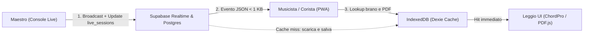

# STRUTTURA-APP.md — Architettura Tecnica e Design System

Questo documento descrive lo stack tecnologico, l'organizzazione del codice, lo schema PostgreSQL con RLS, l'architettura Realtime/Offline, il Design System di **Arion** e il percorso verso il self-hosting.

---

## 1. Stack Tecnologico

### Frontend & PWA

- **Framework:** React 19 + TypeScript (`strict: true`, `noUncheckedIndexedAccess: true`)
- **Build tool:** Vite + `vite-plugin-pwa` (Workbox)
- **Stile:** Tailwind CSS + CSS custom properties per i 3 temi (`daylight`, `stage_dark`, `oled_black`)
- **Routing:** React Router
- **Icone:** `lucide-react` + componente SVG proprietario `ArionLogo` (delfino stilizzato)
- **Rendering PDF:** `pdfjs-dist` (rendering su `<canvas>` senza `<iframe>` nativi)
- **Import `.docx`:** `mammoth` (conversione browser-side senza costi server)
- **Storage offline:** `dexie` (wrapper tipizzato su IndexedDB)

### Backend (Fase 1 a 0 €/mese — Self-Host Ready)

- **Piattaforma:** Supabase (Piano Free in partenza: PostgreSQL 15+, Auth Magic Link + OTP 6 cifre, Storage privato, Realtime Broadcast + Presence)
- **SDK Client:** `@supabase/supabase-js` incapsulato dietro `src/services/`
- **Ambiente locale:** Supabase CLI + Docker (Postgres, GoTrue Auth, PostgREST, Storage, Realtime, Mailpit/Inbucket per email locali)

### Qualità, Linting & Testing

- **Lint & Format:** ESLint (flat config) + Prettier
- **Unit & Integration Test:** Vitest + React Testing Library
- **Security / RLS Test:** Vitest contro istanza Supabase locale in Docker (`tests/rls/`)
- **End-to-End Multi-Utente:** Playwright (`tests/e2e/`, es. Maestro + Musicista in contesti browser paralleli)

---

## 2. Struttura delle Directory

```text
arion/
├── AGENTS.md
├── docs/
│   ├── SPECIFICHE.md
│   ├── STRUTTURA-APP.md
│   └── fasi/
│       ├── fase-1.md
│       └── roadmap.md
├── public/
│   ├── icons/                      # Icone PWA generate dal logo Arion (192, 512, apple-touch-icon)
│   └── pdf.worker.min.mjs          # Worker locale PDF.js per funzionamento offline
├── supabase/
│   ├── config.toml                 # Configurazione Supabase CLI locale (email OTP, redirect, buckets)
│   ├── migrations/                 # Migrazioni SQL ordinate cronologicamente (tabelle, funzioni, RLS, storage)
│   ├── templates/                  # Template email in italiano (Magic Link + Codice OTP 6 cifre)
│   └── seed.sql                    # Dati demo esclusivamente generici (@arion.local, "Coro Demo")
├── src/
│   ├── main.tsx
│   ├── App.tsx
│   ├── index.css                   # Token Tailwind e variabili temi Deep Marine Stage
│   ├── i18n/
│   │   └── it.ts                   # UNICA fonte delle stringhe UI in italiano
│   ├── domain/                     # Logica pura (zero dipendenze da React o Supabase)
│   │   ├── rbac/
│   │   │   ├── permissions.ts      # Tipo Permission, Role, ROLE_PERMISSIONS, helper can()
│   │   │   └── permissions.test.ts
│   │   ├── chords/
│   │   │   ├── types.ts            # Modello astratto accordo, notazione, tonalità
│   │   │   ├── parser.ts           # Normalizzazione accordi ITA/ENG e formati misti
│   │   │   ├── transposer.ts       # Circolo quinte, enarmonia, strumento traspositore, capotasto
│   │   │   ├── chordpro.ts         # Parser strutturale ChordPro (sezioni, righe, solo testo)
│   │   │   └── importer.ts         # Euristica "accordi sopra -> inline" + pulizia testo
│   │   └── models/                 # Tipi di dominio (UserProfile, Instrument, Song, Setlist, LiveState)
│   ├── services/                   # Adapter infrastrutturali (disaccoppiamento backend)
│   │   ├── supabaseClient.ts
│   │   ├── authService.ts
│   │   ├── instanceService.ts
│   │   ├── usersService.ts
│   │   ├── instrumentsService.ts
│   │   ├── songsService.ts
│   │   ├── storageService.ts       # Astrazione upload/download/signed-URL (pronta per backend alternativi)
│   │   ├── setlistsService.ts
│   │   ├── liveService.ts          # Persistenza live_sessions + canali Broadcast/Presence
│   │   └── offlineDb.ts            # Schema Dexie IndexedDB per cache brani, scalette e PDF
│   ├── components/                 # Componenti UI condivisi e design system
│   │   ├── ArionLogo.tsx
│   │   ├── PageHeader.tsx
│   │   ├── RequirePermission.tsx
│   │   ├── AppShell.tsx            # Navbar inferiore a 5 tab (mobile/tablet) + sidebar desktop + header compatto
│   │   ├── ConnectionBadge.tsx
│   │   └── ThemeProvider.tsx
│   └── features/
│       ├── auth/                   # Login email -> Magic Link + input OTP 6 cifre
│       ├── home/                   # Home operativa: saluto, prossimo appuntamento, stato Live, accesso rapido
│       ├── admin/                  # Pannello Admin: istanza white-label, utenti/inviti, catalogo strumenti
│       ├── profile/                # Profilo musicale multi-strumento e selettore rapido 1-tap
│       ├── repertoire/             # Lista brani, ricerca/tag, leggio, editor ChordPro, wizard import .docx, PDF
│       ├── reader/                 # Leggio unificato (ChordPro renderer, PDF.js canvas, Night Score, Wake Lock, pedale)
│       ├── setlists/               # Gestione scalette, riordino, override tonalità, lettura in sequenza
│       ├── live/                   # Console Maestro, Vista Musicista/Corista, Presenza, Segnali lampo, Banner prossimo
│       ├── calendar/               # Calendario musicale: prove, esibizioni/concerti, servizi con collegamento a scalette
│       ├── more/                   # Menu Altro, Preferenze utente, Guida, Assistenza, Privacy, Info app
│       └── offline/                # Banner installazione iOS/Android, gestione cache "Prepara offline"
└── tests/
    ├── unit/                       # Test aggiuntivi su hook/utility/importer
    ├── rls/                        # Suite automatica di sicurezza PostgreSQL RLS
    └── e2e/                        # Test Playwright multi-utente (Maestro + Musicista)
```

---

## 3. Schema Database PostgreSQL

Tutte le tabelle risiedono nello schema `public` e utilizzano `uuid` come chiavi primarie (`gen_random_uuid()`), `timestamptz` in UTC e vincoli referenziali espliciti.

### 3.1 Configurazione istanza e sicurezza utenti

- **`instance_settings`** (singleton, `id = 1` con vincolo `CHECK (id = 1)`):
  - `id integer primary key default 1`
  - `group_name text not null default 'Il Mio Coro'`
  - `group_subtitle text`
  - `logo_path text` (percorso nello bucket privato `instance-branding`)
  - `default_notation text not null default 'italian'` (`'italian' | 'english'`)
  - `default_theme text not null default 'daylight'` (`'daylight' | 'stage_dark' | 'oled_black'`)
  - `updated_at timestamptz not null default now()`
- **`allowed_emails`** (whitelist inviti gestita dall'Admin):
  - `id uuid primary key`
  - `email text unique not null` (normalizzata lowercase con vincolo `CHECK (email = lower(trim(email)))`)
  - `role text not null` (`'admin' | 'conductor' | 'musician'`)
  - `display_name text`
  - `default_instrument_ids uuid[] not null default '{}'`
  - `is_active boolean not null default true`
  - `invited_by uuid references auth.users(id)`
  - `created_at timestamptz not null default now()`
- **`profiles`** (estensione di `auth.users`, 1:1):
  - `id uuid primary key references auth.users(id) on delete cascade`
  - `email text unique not null`
  - `display_name text not null`
  - `role text not null` (`'admin' | 'conductor' | 'musician'`)
  - `is_active boolean not null default true`
  - `active_instrument_id uuid` (FK verso `instruments(id)` con `on delete set null`)
  - `preferred_notation text not null default 'italian'`
  - `preferred_theme text not null default 'daylight'`
  - `font_scale numeric(3,2) not null default 1.00`
  - `created_at`, `updated_at`

### 3.2 Catalogo Strumenti e Preferenze Musicali

- **`instruments`**:
  - `id uuid primary key`
  - `slug text unique not null`
  - `name text not null`
  - `category text not null` (`'voice' | 'instrument'`)
  - `default_view text not null` (`'lyrics_only' | 'chords' | 'pdf'`)
  - `transposition_semitones smallint not null default 0`
  - `supports_capo boolean not null default false`
  - `is_enabled boolean not null default true`
  - `sort_order integer not null default 100`
- **`user_instruments`** (relazione N:M tra utenti e strumenti/voci):
  - `user_id uuid references profiles(id) on delete cascade`
  - `instrument_id uuid references instruments(id) on delete cascade`
  - `is_primary boolean not null default false`
  - `primary key (user_id, instrument_id)`
- **`user_song_preferences`** (preferenze locali per utente e brano, già predisposta per Fase 2):
  - `user_id uuid references profiles(id) on delete cascade`
  - `song_id uuid references songs(id) on delete cascade`
  - `capo_frets smallint not null default 0 check (capo_frets between 0 and 11)`
  - `preferred_view text` (`null | 'lyrics_only' | 'chords' | 'pdf'`)
  - `preferred_asset_id uuid`
  - `personal_notes text` _(colonna già presente per Fase 2, UI non esposta in Fase 1)_
  - `updated_at timestamptz not null default now()`
  - `primary key (user_id, song_id)`

### 3.3 Repertorio e Allegati Polimorfici

- **`songs`**:
  - `id uuid primary key`
  - `title text not null`
  - `subtitle text`
  - `author text`
  - `original_key text not null default 'Do'`
  - `tempo_bpm smallint`
  - `time_signature text`
  - `tags text[] not null default '{}'`
  - `chordpro_content text not null default ''`
  - `conductor_notes text`
  - `created_by uuid references profiles(id) on delete set null`
  - `updated_by uuid references profiles(id) on delete set null`
  - `created_at`, `updated_at`
- **`song_assets`** (polimorfica per PDF in Fase 1, MIDI/MusicXML in Fasi 2–3):
  - `id uuid primary key`
  - `song_id uuid not null references songs(id) on delete cascade`
  - `asset_type text not null` (`'pdf' | 'midi' | 'musicxml'`)
  - `title text not null`
  - `storage_path text not null`
  - `mime_type text not null`
  - `file_size_bytes bigint not null default 0`
  - `instrument_ids uuid[] not null default '{}'` (vuoto = visibile a tutti)
  - `metadata jsonb not null default '{}'::jsonb` (es. `page_count` in Fase 1; `sync_markers` / `tracks` in Fasi 2–3)
  - `sort_order integer not null default 100`
  - `created_by uuid references profiles(id) on delete set null`
  - `created_at timestamptz not null default now()`

### 3.4 Scalette, Calendario Musicale e Sessione Live

- **`setlists`**:
  - `id uuid primary key`
  - `title text not null`
  - `event_date date`
  - `notes text`
  - `created_by uuid references profiles(id) on delete set null`
  - `created_at`, `updated_at`
- **`setlist_items`**:
  - `id uuid primary key`
  - `setlist_id uuid not null references setlists(id) on delete cascade`
  - `song_id uuid not null references songs(id) on delete cascade`
  - `position integer not null`
  - `override_key text`
  - `notes text`
  - `unique (setlist_id, position)` deferrable per riordino atomico
- **`calendar_events`** (impegni del coro: prove, esibizioni/concerti, servizi):
  - `id uuid primary key`
  - `title text not null`
  - `category text not null` (`'rehearsal' | 'concert' | 'service' | 'other'`)
  - `event_date date not null`
  - `start_time time not null`
  - `end_time time`
  - `location text`
  - `setlist_id uuid references setlists(id) on delete set null`
  - `notes text`
  - `created_by uuid references profiles(id) on delete set null`
  - `created_at`, `updated_at`
- **`live_sessions`** (singleton per istanza in Fase 1, `id = 1`, stato persistito di fallback/riconnessione):
  - `id integer primary key default 1 check (id = 1)`
  - `is_active boolean not null default false`
  - `conductor_id uuid references profiles(id) on delete set null`
  - `setlist_id uuid references setlists(id) on delete set null`
  - `active_setlist_item_id uuid references setlist_items(id) on delete set null`
  - `active_song_id uuid references songs(id) on delete set null`
  - `active_key text`
  - `active_section_index integer`
  - `active_page integer`
  - `next_song_id uuid references songs(id) on delete set null`
  - `next_song_key text`
  - `flash_signal jsonb` (es. `{ id, message, issuedAt }`)
  - `updated_at timestamptz not null default now()`

---

## 4. Sicurezza Backend (RLS, Auth Whitelist e Storage)

### 4.1 Funzioni Helper SQL (`SECURITY DEFINER`)

Per mantenere le policy RLS leggibili ed evitare ricorsioni su `profiles`:

- `public.is_active_user() returns boolean`: verifica `auth.uid()` e controlla che esista un profilo con `is_active = true`.
- `public.current_user_role() returns text`: restituisce il `role` del profilo attivo corrente (o `null` se disattivato).
- `public.has_any_role(roles text[]) returns boolean`: vero se l'utente è attivo e il suo ruolo è nell'array.

### 4.2 Protezione Auth & Anti-Privilege Escalation

1. **Signup solo su invito (`BEFORE INSERT` su `auth.users` o Auth Hook / trigger dedicato):** verifica che `lower(new.email)` esista in `allowed_emails` con `is_active = true`; in caso contrario rifiuta la creazione dell'account. _(Nota: configurare inoltre su Supabase Auth la disabilitazione di signup esterni non invitati o bloccarli via trigger DB prima ancora che venga creato l'utente)._
2. **Provisioning automatico profilo (`AFTER INSERT` su `auth.users`):** crea la riga in `profiles` leggendo `role` e `display_name` da `allowed_emails`, e popola `user_instruments` con `default_instrument_ids`.
3. **Blocco modifica campi privilegiati su `profiles`:** un trigger `BEFORE UPDATE` (o policy RLS con `WITH CHECK`) impedisce a chi non è `admin` di cambiare `role`, `is_active` o `email`.
4. **Guardia ultimo Admin:** un trigger `BEFORE UPDATE OR DELETE` su `profiles` blocca l'operazione se riduce a zero gli `admin` attivi.

### 4.3 Storage Policies (Bucket Privati)

- Bucket `song-assets` (**privato**, dimensione massima per file configurata, MIME consentiti: `application/pdf` in Fase 1):
  - `SELECT`: consentita solo a utenti autenticati attivi (`is_active_user()`).
  - `INSERT` / `UPDATE` / `DELETE`: consentita solo a `admin` e `conductor`.
- Bucket `instance-branding` (**privato** o lettura autenticata per logo personalizzato):
  - `SELECT`: utenti autenticati attivi (e lettura logo pubblico minimale se mostrato pre-login, oppure logo mostrato dopo login lasciando il logo delfino Arion nella schermata di login). _Scelta di privacy predefinita: prima del login viene mostrato solo Arion; nome gruppo e logo personalizzato dell'istanza vengono caricati solo dopo autenticazione (o configurati come visibili solo se l'Admin lo abilita)._
  - `INSERT` / `UPDATE` / `DELETE`: solo `admin`.

### 4.4 Matrice Test RLS Automatici (`tests/rls/`)

Ogni test avvia client Supabase autenticato con JWT reale per ciascuno dei 4 profili di test (`anon`, `musician`, `conductor`, `admin`) su Supabase locale:

- `anon` non può leggere o scrivere alcuna tabella di repertorio, scalette, utenti o live.
- `musician` può leggere brani/scalette/strumenti abilitati e aggiornare solo il proprio `profiles` (esclusi `role`/`is_active`), `user_instruments` e `user_song_preferences`; riceve errore `42501` se tenta di modificare `role`, creare brani, caricare PDF, modificare scalette o aggiornare `live_sessions`.
- `conductor` può gestire `songs`, `song_assets`, `setlists`, `setlist_items`, `live_sessions` e storage `song-assets`; riceve errore se tenta di modificare `instance_settings`, `allowed_emails`, `instruments` o ruoli utente.
- `admin` ha accesso completo e viene comunque bloccato dal DB se tenta di disattivare o retrocedere se stesso quando è l'unico `admin` attivo.

---

## 5. Architettura Realtime Live & Cache Offline

La sincronizzazione Live combina **stato persistito su Postgres (`live_sessions`)** con **Supabase Realtime Broadcast + Presence** sul canale `live:main`:

- **Broadcast:** trasporta immediatamente i payload leggeri (`< 1 KB`) per cambio brano, cambio tonalità, sezione/pagina attiva, banner "Prossimo brano" e segnali lampo.
- **Persistenza su `live_sessions`:** garantisce che chi entra a metà prova, ricarica l'app o rientra dopo un micro-calo di segnale trovi immediatamente lo stato esatto corrente.
- **Presence:** traccia in tempo reale i dispositivi connessi, il nome, lo strumento attivo e lo stato (`synced` / `detached`) per il pannello del Maestro.



### Schema Cache Offline (`src/services/offlineDb.ts` via Dexie)

- `songs`: brani completi + `updatedAt` per invalidazione incrementale.
- `setlists`: scalette e relativi `setlistItems`.
- `assetsMeta` & `assetBlobs`: metadati e `Blob` binari dei PDF scaricati (con dimensione totale tracciata per mostrare all'utente quanto spazio occupa la cache offline e permetterne la pulizia).

---

## 6. Design System & Identità Visiva ("Arion — Carta Editoriale & Palco")

Per offrire un'interfaccia sobria, realistica e leggibile sia nella preparazione quotidiana sia sul leggio in ambienti poco illuminati, Arion adotta una palette ispirata alla **carta musicale e all'inchiostro marittimo**, con tre temi selezionabili:

| Token                              | _Chiaro_ (`daylight`, Default)   | _Palco Notturno_ (`stage_dark`) | _Nero OLED_ (`oled_black`) |
| ---------------------------------- | -------------------------------- | ------------------------------- | -------------------------- |
| Background primario                | `#F8F7F4` (carta calda)          | `#111317` (ardesia scura)       | `#000000` (nero puro)      |
| Surface / Card                     | `#FFFFFF`                        | `#181B21`                       | `#0D0F13`                  |
| Bordi sottili                      | `#E2DDD3`                        | `#2B303B`                       | `#242933`                  |
| Testo principale (Lyrics)          | `#1C1917`                        | `#F2F1EE`                       | `#F2F1EE`                  |
| Accordi (Chords)                   | `#1B3B5A` (inchiostro marittimo) | `#E5B869` (ottone caldo opaco)  | `#E5B869`                  |
| Primario / Navigazione attiva      | `#1B3B5A`                        | `#2B5278`                       | `#2B5278`                  |
| Accento editoriale (Filetti/Badge) | `#8F6A2E` (ottone editoriale)    | `#C9A25B`                       | `#C9A25B`                  |
| Live attivo / Avvisi               | `#9B2226` / `#92400E`            | `#E06D70` / `#E5B869`           | `#E06D70` / `#E5B869`      |

### Architettura di Navigazione & Linee guida UI

- **Navigazione mobile/tablet (`< lg`):** barra inferiore fissa a **5 destinazioni** con safe-area iOS: `Home`, `Repertorio`, **`Live` (pulsante centrale prominente)**, `Calendario`, `Altro`.
- **Navigazione desktop (`>= lg`):** barra laterale sinistra fissa con le stesse 5 destinazioni e footer discreto di versione.
- **Sezione `Altro`:** raggruppa in righe pulite `Scalette`, `Guida all'uso`, `Profilo e preferenze`, `Amministrazione` (se abilitato), `Assistenza tecnica e feedback`, `Privacy e integrità dei dati` e `Informazioni sull'app`.
- **Logo Arion:** delfino stilizzato sobrio in inchiostro marittimo e ottone, in SVG vettoriale per favicon e icone PWA.
- **Tipografia:** sans-serif nitido (`Inter` / system-ui) per UI e testi dei brani, serif editoriale di sistema per i titoli principali (zero richieste a CDN esterni), preferenza accessibilità `Compatto` (`100%`) / `Esteso` (`112.5%`).
- **Ergonomia touch:** pulsanti `>= 44x44px`, bordi sottili da `1px`, filetti editoriali sobri sotto i titoli di pagina e toggle rapido `Chiaro / Palco Notturno` direttamente nel leggio.

---

## 7. Ambiente Locale, Sandbox Multi-Utente & Percorso Self-Hosting

### 7.1 Prerequisiti macchina di sviluppo (macOS)

Sul tuo Mac risultano già installati **Git**, **Node.js v24** e **npm v11**.
Prima della **Milestone 1.1** (quando introdurremo il database locale e i test RLS) serviranno:

1. **Docker** (Docker Desktop, OrbStack o Colima) per eseguire lo stack Supabase locale.
2. **Supabase CLI** (`brew install supabase/tap/supabase`).

### 7.2 Sandbox Multi-Utente in locale

- `supabase start` avvia Postgres, Auth, Storage, Realtime e **Mailpit/Inbucket** locale (`http://localhost:54324`) per intercettare e leggere istantaneamente i Magic Link e i codici OTP a 6 cifre senza inviare email vere.
- `supabase/seed.sql` popola esclusivamente account fittizi (`admin@arion.local`, `maestro@arion.local`, `musicista@arion.local`) e 2–3 brani dimostrativi di pubblico dominio.
- Aprendo due profili browser diversi (es. finestra normale per il Maestro + finestra in incognito o Playwright per il Musicista) si può collaudare tutto il flusso Live in locale.

### 7.3 Percorso verso il Self-Hosting futuro

- Poiché database, Auth, Realtime e Storage usano esclusivamente primitive standard Supabase + PostgreSQL RLS e il frontend passa da `src/services/`, spostare in futuro l'istanza da Supabase Cloud Free a un server proprio (VPS, mini-PC o NAS con **Supabase Self-Hosted via Docker Compose**) richiederà solo:
  1. esportare/applicare le stesse `supabase/migrations/`;
  2. copiare i file dei bucket;
  3. aggiornare `VITE_SUPABASE_URL` e `VITE_SUPABASE_ANON_KEY` verso il proprio dominio HTTPS.
